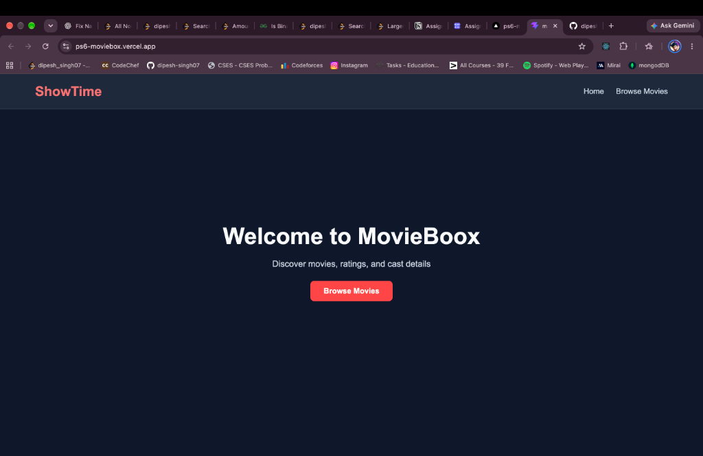
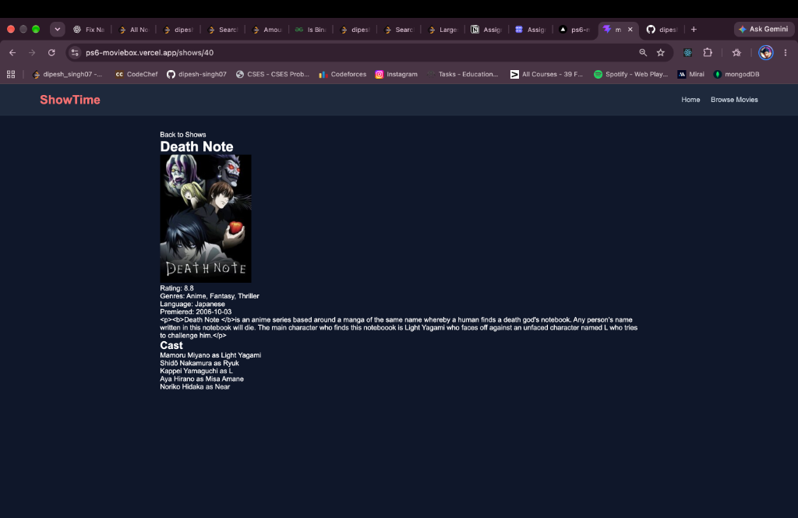

# PS6 — MovieBox: TV Show Explorer

A responsive TV show exploration web application built with React, React Router, and Vanilla CSS, powered by the TVMaze Public API.

---

## 📌 Project Overview
- **PS Number**: PS6
- **Project Name**: MovieBox (TV Show Explorer)
- **GitHub Repository**: `https://github.com/dipesh-singh07/ps6-moviebox`
- **Live Deployment**: `https://ps6-moviebox.vercel.app`

---

## 🌐 API Used
- **Data Source**: [TVMaze Public REST API](https://www.tvmaze.com/api) (No API key required)
  - **Shows List**: `GET https://api.tvmaze.com/shows?page=0` — Fetches series metadata (title, poster, genres, rating).
  - **Show Details**: `GET https://api.tvmaze.com/shows/:id` — Fetches detailed synopsis, genres, status, and premier date.
  - **Show Cast**: `GET https://api.tvmaze.com/shows/:id/cast` — Fetches actor names and character details.

---

## 🗺️ List of Routes
| Route | Page / Component | Description |
| :--- | :--- | :--- |
| `/` | `Home` | Welcome landing page with navigation to browse shows |
| `/shows` / `/movies` | `Movies` | Shows catalog featuring live search and genre filtering |
| `/shows/:id` | `ShowDetails` | Comprehensive show view with synopsis and cast members |

---

## 📸 Screenshots

### 1. Home & Browse Shows Page


### 2. Show Details & Cast Page


*(Note: Add your screenshot images to the `screenshots/` directory or replace the paths above with your hosted image URLs)*

---

## 🚀 Features
- 🔍 **Real-Time Search**: Filter shows instantly by title.
- 🎭 **Genre Filtering**: Filter by Drama, Comedy, Action, Thriller, or All.
- 📄 **Show Details**: Full synopsis, genre tags, premiere dates, and star ratings.
- 👥 **Cast Information**: Display actor names and corresponding character roles.
- ⚡ **Direct URL Routing**: Configured with `vercel.json` SPA rewrites so direct navigation and page refreshes work seamlessly.

---

## 🛠️ Tech Stack
- **Frontend**: React 19, Vite, React Router DOM v7
- **Styling**: Vanilla CSS (Responsive Dark Mode)
- **Hosting**: Vercel

---

## 💻 Local Setup & Installation

1. **Clone the repository:**
   ```bash
   git clone https://github.com/dipesh-singh07/ps6-moviebox.git
   cd ps6-moviebox
   ```

2. **Install dependencies:**
   ```bash
   npm install
   ```

3. **Start the local development server:**
   ```bash
   npm run dev
   ```

4. **Build for production:**
   ```bash
   npm run build
   ```
